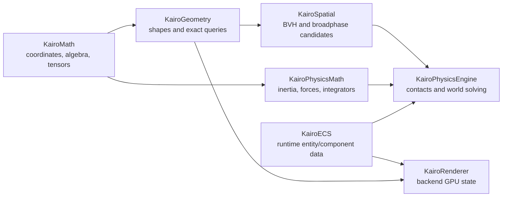

# Kairo foundations — read, implement, verify

This cross-repository study path connects three mathematical repositories and the first runtime data-storage component. Use it alongside [the full portfolio reading order](PORTFOLIO_READING_ORDER.md) and [the annotation status ledger](ANNOTATION_PROGRESS.md). The goal is to understand how Kairo's APIs interoperate rather than memorize independent formulas.

## Course map



The arrows indicate dependencies or conceptual data flows, not proof that every version-pinned integration passes in the current workspace.

## 1. Start with value types and conventions

Read [KairoMath walkthrough](https://github.com/swayam8624/KairoMath/blob/docs/teaching-walkthrough-20261121/docs/MATH_FOUNDATIONS_WALKTHROUGH.md). Then read its [complete source map](https://github.com/swayam8624/KairoMath/blob/docs/teaching-walkthrough-20261121/docs/SOURCE_READING_ORDER.md) beginning with `Vector.cppm`, `Matrix.cppm`, `Quaternion.cppm`, and `Transform.cppm`.

Learn the distinction between row-major *storage* and column-vector *algebra*. Make a C++23 test that constructs translation, rotation and scale independently, composes their matrices and verifies the resulting point and direction. Test normals under nonuniform scale and examine why a naive inverse or direct matrix upload can be wrong.

**Gate to proceed:** explain in your own words why `A*B*v` applies B first, why `w=0` excludes translation, and why a singular matrix cannot have an inverse. Use the actual MathTests, not a rendered screenshot, as verification.

## 2. Turn the numbers into geometric witnesses

Read the [KairoGeometry walkthrough](https://github.com/swayam8624/KairoGeometry/blob/docs/teaching-walkthrough-20261121/docs/GEOMETRY_WALKTHROUGH.md), then [its source map](https://github.com/swayam8624/KairoGeometry/blob/docs/teaching-walkthrough-20261121/docs/SOURCE_READING_ORDER.md).

Start with rays, lines, segments, planes and triangles. Derive the projection `t=dot(P-O,D)/dot(D,D)`, then show how Ray clamps t to nonnegative values and Segment clamps it to [0,1]. Next implement closest points, signed sphere/capsule distance and ray-triangle intersection. Finally build an AABB tree demonstration that filters impossible candidate pairs while still sending survivors to exact geometric queries.

**Gate:** demonstrate a broadphase false positive and correctly explain why the narrowphase rejects it. Check degenerate triangles, parallel rays, coplanar cases and tolerance sensitivity.

## 3. Connect geometry to physical mass and motion

Read the [KairoPhysicsMath walkthrough](https://github.com/swayam8624/KairoPhysicsMath/blob/docs/teaching-walkthrough-20261121/docs/PHYSICS_MATH_WALKTHROUGH.md) and [its complete source map](https://github.com/swayam8624/KairoPhysicsMath/blob/docs/teaching-walkthrough-20261121/docs/SOURCE_READING_ORDER.md).

Use a sphere and box whose geometric dimensions match their mass-property inputs. Calculate density-to-mass, diagonal inertia, world inverse inertia, force torque and impulse-at-point. Compare `ExplicitEuler`, `SemiImplicitEuler` and `VerletPosition` over multiple dt values. Construct a contact with a normal and penetration depth from Geometry, then independently compute its effective mass and impulse.

**Gate:** show the correct units for acceleration, angular velocity, impulse and inertia; explain why the collision solver needs both inverse mass and inverse inertia. Run the formula test suite before describing the result as verified.

## 4. Represent a runtime world without coupling every module

Read the [KairoECS tutorial](https://github.com/swayam8624/KairoECS/blob/docs/teaching-walkthrough-20261121/docs/ECS_WALKTHROUGH.md) and source-map inventory. Create an entity with `Position`, `Velocity` and `RigidBody`-like components. Update those components through typed queries. Keep the authored scene's durable identity distinct from transient entity index/generation.

**Gate:** destroy and recycle an entity index, then prove a stale handle cannot read the next lifetime's components. Explain why swap-remove invalidates references and why structural changes are forbidden inside some iteration callbacks.

## 5. Trace those results into runtime systems

Only after the foundations, open [KairoSpatial](https://github.com/swayam8624/KairoSpatial/blob/docs/teaching-walkthrough-20261121/docs/SOURCE_READING_ORDER.md), [KairoPhysicsEngine](https://github.com/swayam8624/KairoPhysicsEngine/blob/docs/teaching-walkthrough-20261121/docs/SOURCE_READING_ORDER.md), [KairoAssets](https://github.com/swayam8624/KairoAssets/blob/docs/teaching-walkthrough-20261121/docs/SOURCE_READING_ORDER.md), [KairoEngineCore](https://github.com/swayam8624/KairoEngineCore/blob/docs/teaching-walkthrough-20261121/docs/SOURCE_READING_ORDER.md), and [KairoRenderer](https://github.com/swayam8624/KairoRenderer/blob/docs/teaching-walkthrough-20261121/docs/SOURCE_READING_ORDER.md).

Trace this entire path:

```text
Authored dimensions / density / transform
  -> Geometry shape + PhysicsMath mass properties
  -> EngineCore/ECS component identity and world state
  -> KairoSpatial overlap candidates
  -> narrowphase exact shape contacts
  -> PhysicsMath constraint and impulse calculations
  -> PhysicsEngine fixed-step world update
  -> Renderer scene extraction and GPU presentation
```

The originating math types should not own a window, GPU device, input loop or an entire scene file. Each subsystem has a separate authoritative state and failure boundary.

## 6. Capstone exercise: moving spheres without a game engine

Write a small C++23 program using KairoMath and KairoGeometry for two spheres' positions and overlap, KairoPhysicsMath for mass and impulses, and KairoECS for state storage. Advance a **fixed** timestep and log position, linear momentum, and energy before and after an isolated elastic collision. Add tests for stationary bodies, different masses, grazing contacts, overlap correction and extreme but valid dimensions.

Do not claim a physically perfect simulator. A real simulation must additionally consider time-of-impact detection, penetration correction, solver iteration, stability, friction and floating-point error. Use a reference oracle where possible.

## Study and review discipline

Every step should yield (1) executable C++23 code, (2) a readable, self-contained derivation, (3) a test with expected output, and (4) a link to the actual repository function. Keep research claims separate from aesthetic visualizations. The teaching branches annotate the source and link test files, but **they have not passed new local compile/CTest acceptance as part of this pass**.
